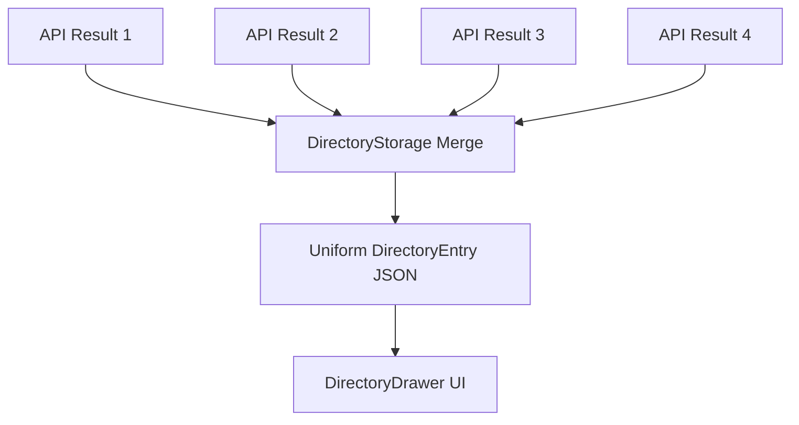

# Phân tích Merge Dữ liệu Đa API (Multi-API Merge Analysis)

Tài liệu này tổng kết cách Fluency gộp dữ liệu từ 4 nguồn khác nhau để tạo ra bộ hồ sơ từ vựng đầy đủ nhất trong `DirectoryDrawer`.

## 1. Các Nguồn Dữ liệu (4 Services)

Dựa trên kết quả chạy script `tests/test_multi_api.sh` cho từ **"run"**, **"susurrus"** và cụm từ **"pick up"**:

| Service | Định dạng | Thế mạnh | Dữ liệu đóng góp chính |
| :--- | :--- | :--- | :--- |
| **Cambridge** | HTML | Độ tin cậy cao nhất | Định nghĩa (Definitions), Ví dụ (Examples), IPA chuẩn |
| **Thesaurus** | HTML/JSON | Quan hệ từ phong phú | Synonyms, Antonyms, **Related Words** |
| **FreeDict** | JSON | Hình thái từ | **Forms** (v2, v3, ing, plurals) |
| **DictAPI** | JSON | Nhanh, Đơn giản | Phonetics, Định nghĩa bổ trợ |

## 2. Cấu trúc Gộp (Merge Logic)

Hệ thống sử dụng logic **Deep Merge** để không làm mất thông tin từ bất kỳ nguồn nào:



### Cách xử lý gộp cụ thể:
1.  **Meanings (Theo PartOfSpeech)**:
    *   Các định nghĩa được gom nhóm theo loại từ (noun, verb...).
    *   Nếu nguồn A và B cùng có "verb", các định nghĩa từ cả hai sẽ được cộng dồn (unique lọc theo text).
2.  **Forms**:
    *   Ưu tiên từ **FreeDict**. Gộp tất cả các biến thể từ mà không ghi đè.
3.  **Related Words (Extra Tabs)**:
    *   **Synonyms/Antonyms**: Gộp từ tất cả các nguồn (Thesaurus, FreeDict, DictAPI).
    *   **Related**: Độc quyền từ Thesaurus.com.
4.  **Phonetics**:
    *   Gộp danh sách IPA, ưu tiên các mục có tag rõ ràng (UK/US).

## 3. Ví dụ Struct sau khi Merge (Term: "run")

```json
{
  "word": "run",
  "phonetics": [
    {"text": "/rʌn/", "tag": "UK"},
    {"text": "/rʌn/", "tag": "US"}
  ],
  "meanings": [
    {
      "partOfSpeech": "verb",
      "definitions": [
        {"definition": "to move fast using ones feet", "example": "He runs every morning."},
        {"definition": "to manage or be in charge of", "example": "She runs a business."}
      ],
      "synonyms": ["dash", "sprint", "manage", "operate"],
      "relatedWords": ["marathon", "sprinting"]
    }
  ],
  "forms": [
    {"word": "runs", "tags": ["present", "3rd person"]},
    {"word": "ran", "tags": ["past"]},
    {"word": "running", "tags": ["present participle"]}
  ]
}
```

## 4. Kết luận
Việc gộp 4 API giúp `DirectoryDrawer` khắc phục điểm yếu của từng nguồn riêng lẻ, đảm bảo người dùng luôn thấy đầy đủ cả **Dạng từ**, **Đồng nghĩa** và **Từ liên quan** trong một giao diện duy nhất.
